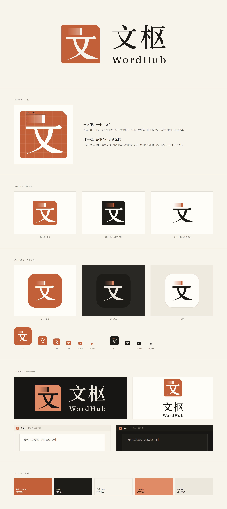

# 文枢 WordHub 标志 v4：文印·生成中

日期：2026-11-09。在 [v3 文印](../logo-v3/README.md) 的基础上做了这些修改：光标加渐变拖尾；横、撇、捺改为手绘书写轮廓，横画水平、宋体三角收笔；印章改为小圆角加右上切角。系统结构（网格、深浅色、尺寸规范、字标组合）不变。



## 释义

- **一方印，一个“文”**：作者的印。白文“文”字逐笔手绘：横画水平、宋体三角收笔；撇长锋出尖；捺由细渐粗、平收出锋。
- **那一点，是正在生成的光标**：“文”字头上那一点是光标，身后拖着一段渐隐的高亮，像 diff 里刚生成的一行，人和 AI 都在这一笔里。

## 颜色规则

| 形态 | 印面 | 字 | 光标 | 拖尾 |
|---|---|---|---|---|
| 朱砂印（主标） | 朱砂 | 镂空 | 镂空 | 渐变半镂空，0 → 40% |
| 墨印 | 墨 | 镂空 | 朱砂 | 朱砂渐变，0 → 55% |
| 无框 | — | 墨 | 朱砂 | 朱砂渐变，0 → 50% |

小尺寸版（≤24px）去掉拖尾，笔画外扩 2.6 加粗。

## 几何（120 网格）

- 印面：(8, 8) 起，104 × 104，圆角 4，右上 45° 切角 10。
- 光标：x 57、y 17，7 × 18；拖尾从 x 24 到光标左缘，与光标等高。
- 横：水平，粗 5，宋体三角收笔（尖点 (95.2, 37.4)）。
- 横、撇、捺：手绘三次贝塞尔轮廓，见 [src/glyph.js](src/glyph.js)。
- 字标：思源宋体 600 写“文枢”，Source Serif 4 450 写“WordHub”；两行左右对齐，上下与印面对齐。文字已转为轮廓。

## 文件

| 文件 | 用途 |
|---|---|
| `seal.svg` / `seal-dark.svg` / `seal-mono.svg` | 主标：朱砂印 / 暗底用的亮朱砂印 / 单色；字为真透明镂空 |
| `seal-ink.svg` | 墨印，朱砂光标与拖尾 |
| `seal-small.svg` / `seal-dark-small.svg` | 小尺寸版（标题栏、favicon） |
| `wen.svg` / `wen-dark.svg` | 无框形态 |
| `lockup.svg` / `lockup-dark.svg` / `lockup-stacked.svg` | 横排 / 暗底横排 / 竖排 |
| `icon-cinnabar.svg` / `icon-ink.svg` / `icon-paper.svg` | 1024 应用图标，不透明 |
| `icon-cinnabar-small.svg` / `icon-ink-small.svg` | 24px 及以下的图标 |
| `logo-board.png` | 展示板（3200 宽） |

## 重新生成

```powershell
npm i --no-save fontkit wawoff2      # 仓库根目录，仅生成时需要
cd docs/design/logo-v4/src
node build.mjs
node render.mjs board.html ../logo-board.png 1600 1000 2
```

## 尚未完成

- 未替换应用内标题栏的 `<Seal glyph="文">`，未生成 `.ico` / `.icns`。
- 拖尾使用渐变；用于刺绣、单色印刷等不支持渐变的场合时，请改用小尺寸版或单色版。
- 未做商标检索。
